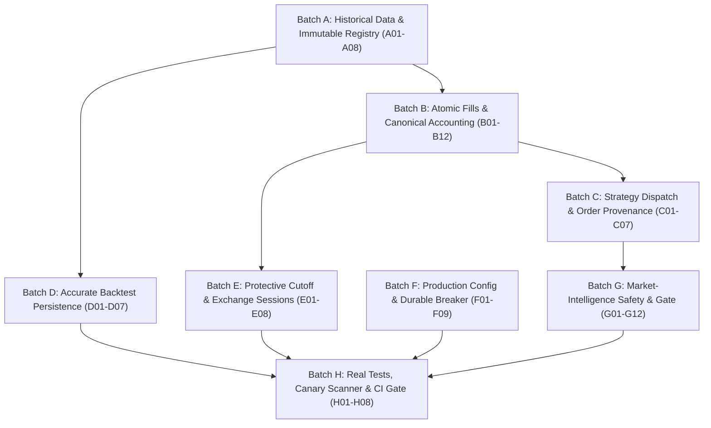

# Algo Lab Comprehensive Remediation Plan

**Repository**: `https://github.com/vijaykumarjogi266-star/algopro`  
**Base Reviewed Commit**: `57c34603506ecf9c28666886cee6bb9027085c29`  
**Active Remediation Branch**: `feature/remediation-v2-plan`  
**Coordinator**: Antigravity Engineering Coordinator  

---

## 1. Prime Invariants & Safety Hierarchy
```text
Capital Preservation ──▶ Data Integrity ──▶ Research Integrity ──▶ Risk Management ──▶ Execution Quality ──▶ Performance
```
* `LIVE_TRADING_ENABLED = False` permanently locked.
* `REAL_BROKER_EXECUTION_ENABLED = False` permanently locked.
* Zero synthetic data substitution for missing historical records.
* Pure double-entry, fill-price-consistent accounting.
* Fail-closed release gate: any missing tool or failed check exits non-zero.

---

## 2. Batch Dependency Architecture & Phasing



---

## 3. Prioritized Batches & Effort Estimation

| Batch | Scope | Findings / Requirements | Estimated Effort | Status |
|---|---|---|:---:|:---:|
| **Batch A** | Historical Data & Immutable Registry | A01–A08: No default synthetic generator, immutable dataset versions, conflict on checksum drift | 2–3 days | **COMPLETED** |
| **Batch B** | Atomic Fills & Canonical Accounting | B01–B12: Atomic portfolio mutation, oversell rejection, single accounting model | 2–3 days | **COMPLETED** |
| **Batch C** | Real Strategy Dispatch & Order Provenance | C01–C07: Registered strategy dispatcher, parameter-driven protection, explicit allocation | 1–3 days | **COMPLETED** |
| **Batch D** | Accurate Backtest Persistence | D01–D07: Real timestamps throughout, distinct cash/asset curves, causal next-open stops | 1–2 days | **COMPLETED** |
| **Batch E** | Protective Cutoff & Exchange Sessions | E01–E08: Valid exchange sessions only, in-session quotes, persistent unresolved exit state | 1–2 days | **COMPLETED** |
| **Batch F** | Production Config & Durable Breaker | F01–F09: Validated settings injection, key strength validation, signed NORMAL persistence | 0.5–1.5 days | **COMPLETED** |
| **Batch G** | Market-Intelligence Safety & Boundaries | G01–G12: Offline fixture separation, finite ratio checks, upstream risk cap enforcement | 2–3 days | **COMPLETED** |
| **Batch H** | Real Tests, Locks, Builds & CI Gate | H01–H08: Portable lock verification, all-layer canary scanning, DOM tests, CI gating | 2–4 days | **ACTIVE / NEXT** |

**Total Estimated Implementation Effort**: **11.5 – 21.5 working days**

---

## 4. Acceptance Criteria per Batch
Every batch must provide:
1. Exact changed files and patch summary.
2. Concrete behavioral regression tests (exercising actual execution, not string assertions).
3. Exact command outputs with exit code `0` and test count delta.
4. Updated finding-to-test verification record in `RELEASE_EVIDENCE.md`.
