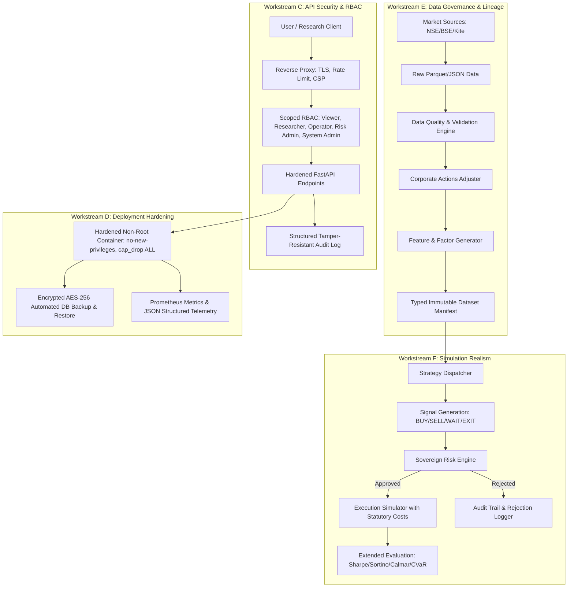

# Algo Lab: Comprehensive Platform Hardening & Remediation Plan (V3)

**Branch**: `feature/platform-hardening`  
**Base Commit**: `74cbc01`  
**Execution Environment**: Strict Paper-Trading & Offline Quantitative Research Only  
**Safety Status**: `LIVE_TRADING_ENABLED = False` (Permanently Hardcoded)

---

## 1. Executive Summary & Non-Negotiable Safety Boundaries

Algo Lab is an institutional quantitative research, backtesting, and forward paper-simulation operating system specifically designed for Indian equity and derivatives markets (NSE, BSE, MCX).

### Non-Negotiable Invariants:
1. `LIVE_TRADING_ENABLED` must remain `False`.
2. `REAL_BROKER_EXECUTION_ENABLED` must remain `False`.
3. Any configuration attempting to enable live broker order submission fails application startup and CI.
4. The Risk Engine is sovereign and independent of all strategies, AI/NLP/news/fundamental engines, and UI actions.
5. Direct order routing from strategy, news, or UI without risk engine approval is structurally prohibited.
6. Missing, stale, malformed, future-dated, or unverified market data yields `WAIT` or rejection—never synthetic substitution.
7. Backtests and forward paper simulations are 100% point-in-time safe, auditable, and versioned.
8. Zero network order transmission to live brokers; secrets never logged or exposed.
9. Backward compatibility preserved where feasible; breaking changes explicitly documented.

---

## 2. Architecture Mapping

---

## 3. Workstream Execution Matrix

| Workstream | Scope & Objectives | Deliverables | Verification Gates |
|---|---|---|---|
| **Workstream A** | Canonical project status, unified versioning, and governance docs | Single source of truth module (`project_state.py`), version synchronization (`0.2.0`), 12-section `README.md`, `CONTRIBUTING.md`, `SECURITY.md`, `CODEOWNERS`, PR/Issue templates, `CHANGELOG.md`, `docs/adr/`. | Doc consistency tests, startup banner verification. |
| **Workstream B** | CI/CD & release integrity | Canonical `make release-check`, hardened GitHub Actions (`ci.yml`), fail-closed gates, SBOM generator (`generate_sbom.py`), lockfile verification. | `make release-check` exit code 0 on Linux x86_64, SBOM validity. |
| **Workstream C** | API security, RBAC, and auditability | 5-role RBAC (`viewer`, `researcher`, `operator`, `risk_admin`, `system_admin`), constant-time key validation, rotation, `X-Request-ID` telemetry, body limits, CSP without `unsafe-inline`. | RBAC unit & integration tests, privilege escalation attack tests. |
| **Workstream D** | Deployment & runtime hardening | Non-root `Dockerfile.api`, hardened `docker-compose.prod.yml`, reverse-proxy Nginx TLS config, encrypted backup/restore scripts (`backup_database.py`), Prometheus `/metrics`. | Backup encryption/decryption roundtrip test, Docker security check. |
| **Workstream E** | Data governance & research reproducibility | Typed dataset manifest (`DatasetManifest`), 5-stage data lineage, pluggable calendar provider (`CalendarProvider`), immutable source/lock hashes. | Data lineage integrity test, calendar holiday test, deterministic replay. |
| **Workstream F** | Backtest realism & risk engine isolation | Explicit simulation contract (`SimulatorContract`), multi-factor metrics (Sortino, Calmar, CVaR, turnover), AST isolation security scanner. | Simulator contract tests, AST gateway isolation scanner. |
| **Workstream G** | Release evidence & quality assurance | Automated `RELEASE_EVIDENCE.md` verification, mypy/pyright typing config, formatting checks. | Release evidence automated validation script. |

---

## 4. Phased Implementation Milestones

1. **Phase 1: Workstream A** (Canonical Project State, Single Source of Truth, Governance Docs, Readme).
2. **Phase 2: Workstream C** (API Role-Based Access Control, Key Hashing, Hardened Security Headers & CSP).
3. **Phase 3: Workstream E** (Data Governance Manifests, Data Lineage Engine, Pluggable Calendar Provider).
4. **Phase 4: Workstream F** (Simulator Execution Contract, Comprehensive Reporting Metrics, AST Isolation Scanner).
5. **Phase 5: Workstream D** (Deployment Hardening, Non-Root Container, Encrypted Backups, Prometheus Metrics).
6. **Phase 6: Workstream B & G** (CI/CD Workflows, SBOM Generator, `make release-check`, Release Evidence Matrix).
