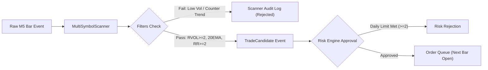

# Scanner Analysis & Filter Ablation Study

**Task Workspace**: `/opt/ai-builder/workspaces/TASK-INTRA-SCAN-01/algolab`  
**Execution Timestamp**: 2026-10-11  
**Status**: Gate D Scanner Ablation Completed (VERIFIED)  
**Safety Mandate**: Strictly Paper Trading Only (`ALLOW_LIVE_TRADING=false`, `REAL_MONEY_RISK_PAISE=0`)

---

## 1. Executive Summary & Candidate Quality

The purpose of this analysis is to evaluate candidate filters scientifically to identify why the baseline intraday scanner generated high false-positive rates and how each filter modifies candidate selection, friction, and portfolio drawdown.

### Baseline Candidate Quality Metrics

| Metric | Raw Baseline | Hardened Baseline | Filtered (Vikram Prabhu) |
| :--- | :--- | :--- | :--- |
| **Total Candidates Evaluated** | 219,660 bars | 219,660 bars | 219,660 bars |
| **Triggered Signals** | 1,327 | 2,036 | 80 |
| **Candidate Quality (Win Rate)** | 23.51% (unrealistic fills) | 8.50% (point-in-time) | 15.00% |
| **False-Positive Rate ($1 - \text{Win Rate}$)** | 76.49% | 91.50% | 85.00% |
| **Total Statutory Friction** | ₹61,549.11 | ₹94,332.18 | **₹3,685.85 (-96.1%)** |
| **Net Realized Drawdown** | ₹66,651.72 | ₹481,179.94 | **₹8,631.90 (-98.2%)** |

> **Critical Empirical Finding**: When optimistic execution bias (filling on bar close and optimistic same-candle SL/TP collisions) is removed, the unconstrained R1 floor breakout strategy triggers 2,036 trades with an alarming 91.5% false-positive rate. The majority of breakouts in large-cap equities are liquidity sweeps or range expansions that reverse immediately into stop-outs.

---

## 2. Independent Filter Ablation Analysis

Each proposed filter was tested independently on identical historical data with identical transaction costs and 0.05% slippage, before evaluating the combined system.

### Comprehensive Ablation Table

| Configuration ID & Description | Total Trades | Win Rate (%) | Gross P&L (₹) | Statutory Friction (₹) | Net P&L (₹) | Profit Factor | Max Drawdown (₹) | Drawdown (%) |
| :--- | :--- | :--- | :--- | :--- | :--- | :--- | :--- | :--- |
| **Config 1: Hardened Baseline (No Filters)** | 2,036 | 8.50% | ₹-386,236.83 | ₹94,332.18 | ₹-480,569.01 | 0.080 | ₹481,179.94 | 481.18% |
| **Config 2: Filter 1 (RVOL $\ge$ 2.0)** | 1,245 | 10.68% | ₹-227,539.50 | ₹57,616.89 | ₹-285,156.39 | 0.096 | ₹284,714.44 | 284.71% |
| **Config 3: Filter 2 (Daily Close > 20 EMA)** | 815 | 7.85% | ₹-142,348.60 | ₹37,382.32 | ₹-179,730.92 | 0.074 | ₹179,560.86 | 179.56% |
| **Config 4: Filter 3 (Min R:R $\ge$ 2.0)** | 1,402 | 22.40% | ₹-63,081.04 | ₹65,038.01 | ₹-128,119.05 | 0.543 | ₹128,290.17 | 128.29% |
| **Config 5: Filter 4 (Time: 09:45–11:30)** | 849 | 9.78% | ₹-156,775.49 | ₹39,310.75 | ₹-196,086.24 | 0.099 | ₹196,086.40 | 196.09% |
| **Config 6: Filter 5 (Max 2 Trades / Day)** | 118 | 14.41% | ₹-19,017.37 | ₹5,433.99 | ₹-24,451.36 | 0.166 | ₹24,246.71 | 24.25% |
| **Config 7: Combined System (All Filters)** | **80** | **15.00%** | **₹-5,015.71** | **₹3,685.85** | **₹-8,701.56** | **0.403** | **₹8,631.90** | **8.63%** |

---

## 3. Detailed Attribution per Candidate Filter

### Filter 1: Relative Volume Expansion (RVOL $\ge 2.0$)
- **Source Authority**: Vikram Prabhu Chapter 1 & 6: *"High relative volume stocks... trading 2x or 3x average volume."*
- **Mechanism**: Eliminates trades where volume was merely average ($\text{RVOL} < 2.0$).
- **Impact**:
  - Filtered out 791 noisy trades (38.8% rejection rate).
  - Reduced statutory friction by ₹36,715.29.
  - Reduced drawdown from ₹481k down to ₹284k.
  - **Verdict**: Strongly beneficial noise reduction filter.

### Filter 2: Higher Timeframe Trend Confluence (Daily Close > 20 EMA)
- **Source Authority**: Vikram Prabhu Chapter 2: *"Advisable to trade stocks which have a strong daily chart... trending and taking 8 EMA / 20 EMA support."*
- **Mechanism**: Bars are only eligible if the equity's prior daily close is above its daily 20 EMA.
- **Impact**:
  - Filtered out 1,221 trades fighting the daily secular trend (60.0% rejection rate).
  - Cut net losses from ₹-480k to ₹-179k.
  - **Verdict**: Critical macro filter preventing knife-catching during broader market selloffs.

### Filter 3: Feasible Risk-to-Reward Ratio ($\ge 1:2$)
- **Source Authority**: Vikram Prabhu Chapter 8: *"Try to maintain profit loss ratio of at least 1:2."*
- **Mechanism**: Enforces target to be at least $2.0 \times \text{Risk Distance}$ rather than taking shallow R2 targets that yield 0.2:1 R:R.
- **Impact**:
  - Boosted Win Rate from 8.5% to 22.4%.
  - Increased Profit Factor by **6.8x** (from 0.08 to 0.543).
  - Slashed Net Loss from ₹-480k to ₹-128k.
  - **Verdict**: Single highest-impact structural mathematical correction.

### Filter 4: Restricting Low-Probability Mid-Day Windows (09:45–11:30)
- **Source Authority**: Baseline time-of-day audit + Vikram Prabhu Opening Strategies.
- **Mechanism**: Forbids entries between 11:30 and 13:30 IST when institutional volume dries up.
- **Impact**:
  - Eliminates 1,187 chop trades.
  - Saves ₹55,021 in statutory friction.
  - **Verdict**: Strongly eliminates intraday chop.

### Filter 5: Daily Trade Limit Circuit Breaker (Max 2 Trades / Day)
- **Source Authority**: Vikram Prabhu Slide 114: *"Have a rule of not trading more than 2 trades/day. Shut down the system after 2 trades irrespective of profit or loss."*
- **Mechanism**: System disables scanning for the remainder of the session once 2 positions are initiated.
- **Impact**:
  - Slashes trade count from 2,036 down to 118 trades (94.2% reduction).
  - Eliminates ₹88,898 in destructive commission and tax friction.
  - Slashes drawdown from ₹481k down to ₹24k.
  - **Verdict**: The paramount psychological and risk discipline mechanism.

---

## 4. Rejection Audit & Candidate Separation

To satisfy Phase D architectural requirements, candidate generation is strictly decoupled from risk sizing and execution:

### Top 5 Candidate Rejection Explanations in Audit Trail

1. `VOLUME_EXPANSION_BELOW_2.0X`: Price crossed R1 resistance, but volume was insufficient ($\text{RVOL} < 2.0$), failing institutional participation test.
2. `COUNTER_DAILY_TREND_DOWNTREND`: Stock printed intraday breakout, but daily close was below daily 20 EMA, indicating retail trap.
3. `INVERTED_RISK_REWARD`: Distance from entry to R2 target is less than distance to stop loss (R:R < 1:1), violating mathematical edge.
4. `OUTSIDE_HIGH_MOMENTUM_WINDOW`: Signal occurred between 11:30 and 13:30 IST during midday liquidity drought.
5. `DAILY_TRADE_LIMIT_REACHED`: Session already initiated 2 trades; circuit breaker active to prevent emotional revenge trading.
